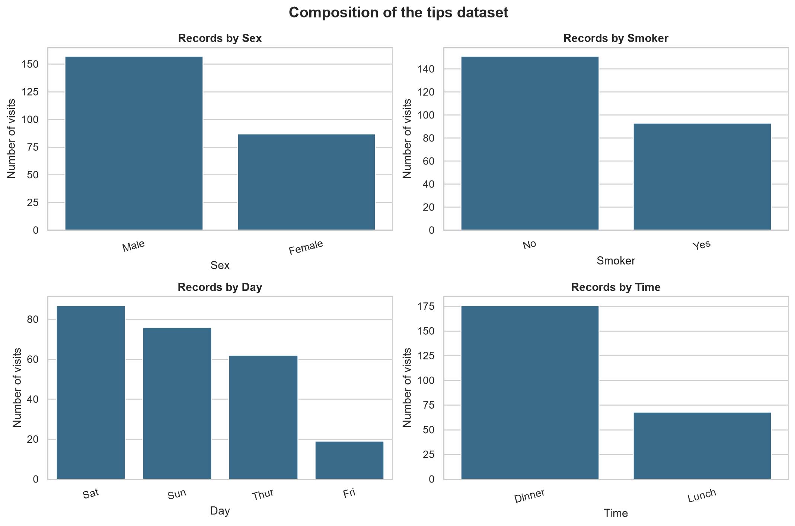
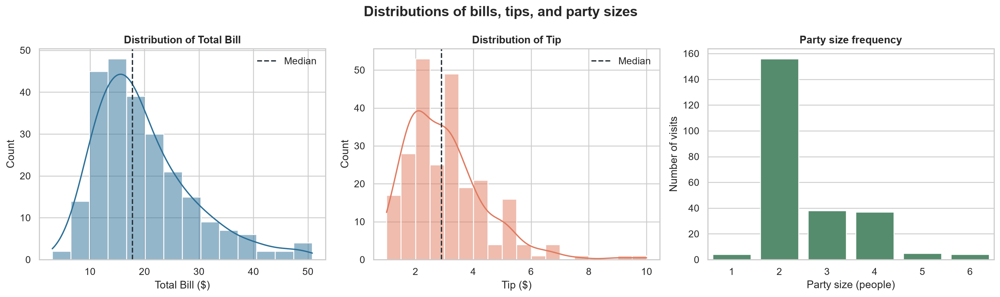
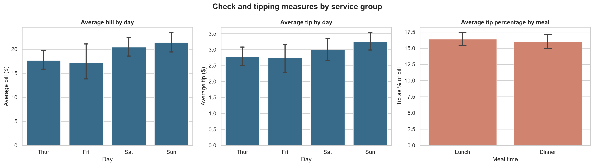
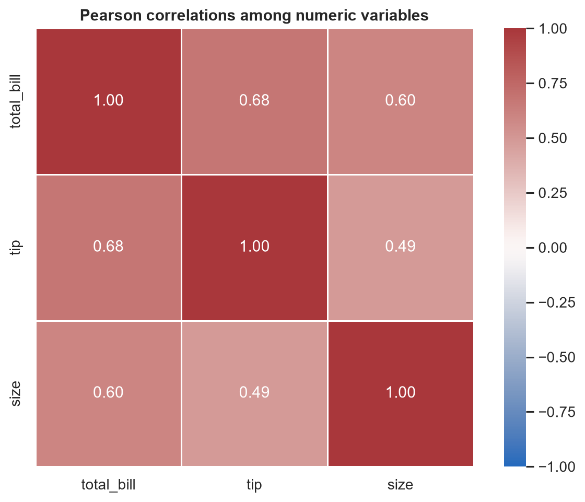
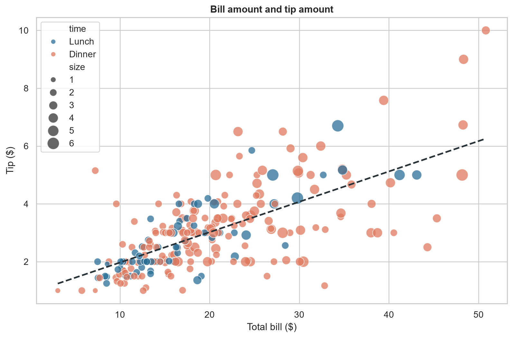

# Tips for Data Analysis

## 1. Introduction

Data analysis is the process of collecting, cleaning, transforming, and analyzing data to discover useful information and make better decisions.

### Popular Python Libraries for Data Analysis
- **NumPy:** Used for numerical calculations and arrays.
- **Pandas:** Used for data manipulation and analysis.
- **Matplotlib:** Used for creating charts and graphs.
- **Seaborn:** Used for statistical data visualization.

## 2. Installation by Creating a Python Virtual Environment

A virtual environment provides an isolated space to install Python packages for a specific project.

### Step 1: Check Python Installation

```bash
python --version
```

### Step 2: Create a Project Folder

```bash
mkdir data-analysis
cd data-analysis
```

### Step 3: Create a Virtual Environment

```bash
python -m venv venv
```

### Step 4: Activate the Virtual Environment

**Windows Command Prompt (CMD):**

```cmd
venv\Scripts\activate.bat
```

**Windows PowerShell:**

```powershell
.\venv\Scripts\Activate.ps1
```

### Step 5: Upgrade pip

```bash
python -m pip install --upgrade pip
```

### Step 6: Install Data Analysis Libraries

```bash
pip install numpy pandas matplotlib seaborn plotly ipykernel openpyxl scipy statsmodels
```

### Step 7: Verify Installation

```bash
python -c "import numpy, pandas, matplotlib, seaborn; print('All libraries installed successfully!')"
```

## 3. Basic Data Analysis Tips

1. Understand your dataset before starting the analysis.
2. Use `head()` to view the first five rows.
3. Use `tail()` to view the last five rows.
4. Use `info()` to check column names and data types.
5. Use `describe()` to get statistical summaries.
6. Use `isnull().sum()` to identify missing values.
7. Use `drop_duplicates()` to identify and remove duplicate records.
8. Create charts and graphs to visualize patterns in the data.

# Complete Analysis

# Restaurant Tips Data: Descriptive Analytics Report

## Executive Summary

This report examines the Seaborn tips dataset, containing 244 observations and seven fields about restaurant bills, tips, party size, meal time, day, smoker status, and sex. The data contains no missing values and one exact duplicate row. Bill and tip amounts are both right-skewed. Sunday has the highest average bill among the observed days, while Friday has the lowest; lunch has a slightly higher average tip percentage than dinner. Bill amount and tip amount have a moderate positive association (Pearson $r = 0.68$). These are descriptive findings from this sample and should not be interpreted as causal effects.

## 1. Data Composition

The dataset contains **244 rows and 7 columns**. All 244 rows have complete values for every field. One pair of rows is an exact duplicate; it is reported here but has not been removed because its origin cannot be determined from the data alone.

| Field | Type | Distinct values |
|---|---|---:|
| `total_bill` | Numeric | 229 |
| `tip` | Numeric | 123 |
| `sex` | Category | 2 |
| `smoker` | Category | 2 |
| `day` | Category | 4 |
| `time` | Category | 2 |
| `size` | Numeric count | 6 |

The records are not evenly distributed across categories: Saturday accounts for 87 observations, Sunday 76, Thursday 62, and Friday 19. Dinner accounts for 176 observations and lunch 68. The sample includes 157 male and 87 female entries, and 151 non-smoker and 93 smoker entries.



**Interpretation.** Weekend days and dinner are more represented in this dataset than Friday and lunch. Comparisons between groups should therefore be read alongside their sample sizes; the groups are not balanced.

## 2. Data Distribution

| Measure | Mean | Median | Standard deviation | Minimum | Maximum | Skewness |
|---|---:|---:|---:|---:|---:|---:|
| Total bill | $19.79 | $17.80 | $8.90 | $3.07 | $50.81 | 1.13 |
| Tip | $3.00 | $2.90 | $1.38 | $1.00 | $10.00 | 1.47 |
| Party size | 2.57 | 2 | 0.95 | 1 | 6 | — |



**Interpretation.** Both money measures are right-skewed: most observations are toward the lower end, with a smaller number of large bills and tips extending the upper tail. Their means exceed their medians, so the median can better represent a typical observation when the impact of unusually high values is a concern. A party size of two is the most frequent.

## 3. Data Comparison

The table reports group means and the number of observations in each group. Tip percentage is calculated per observation as tip divided by bill, then averaged within each group.

| Day | Visits | Mean bill | Mean tip | Mean tip percentage |
|---|---:|---:|---:|---:|
| Thursday | 62 | $17.68 | $2.77 | 16.13% |
| Friday | 19 | $17.15 | $2.73 | 16.99% |
| Saturday | 87 | $20.44 | $2.99 | 15.32% |
| Sunday | 76 | $21.41 | $3.26 | 16.69% |

| Meal time | Visits | Mean bill | Mean tip | Mean tip percentage |
|---|---:|---:|---:|---:|
| Lunch | 68 | $17.17 | $2.73 | 16.41% |
| Dinner | 176 | $20.80 | $3.10 | 15.95% |



**Interpretation.** Sunday has the highest average bill ($21.41; 76 observations), while Friday has the lowest ($17.15; 19 observations). Dinner has a higher mean bill and mean tip than lunch, but lunch has a slightly higher mean tip percentage (16.41% versus 15.95%). Error bars show 95% confidence intervals around the group means. Unequal group sizes, especially the smaller Friday sample, make uncertainty important when comparing apparent differences.

## 4. Data Relationships

| Pair of measures | Pearson correlation | Spearman correlation |
|---|---:|---:|
| Total bill and tip | 0.68 | 0.68 |
| Total bill and party size | 0.60 | 0.60 |
| Tip and party size | 0.49 | 0.47 |





**Interpretation.** Bill amount and tip amount have a moderate positive association: larger bills tend to accompany larger tips in this sample. Their Pearson and Spearman correlations are similar, indicating a similar positive pattern whether measured linearly or by ranked values. Party size is also positively associated with both bill and tip. Correlation does not establish cause and effect, and the bill-tip association should be considered alongside the tip percentage comparison.

## Conclusion and Limitations

The dataset is complete but contains one exact duplicate, and category counts are uneven. Bills and tips have right-skewed distributions; Sunday records have the highest mean bill, and lunch records have the highest mean tip percentage. Bill and tip amounts move together moderately in this sample.

These results describe the available observations only. The data does not establish that day, meal time, party size, or bill amount causes a difference in tipping behavior. Group averages can also be affected by the uneven sample sizes and by unusually large observations. The 95% confidence intervals communicate uncertainty around means but do not replace a study design or a formal causal analysis.


